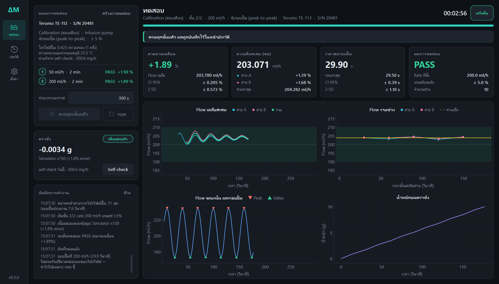

# DeltaM — Calibration & Inspection: Infusion / Syringe Pump

โปรแกรมสอบเทียบ/ตรวจสอบ flow rate ของ Infusion pump และ Syringe pump ด้วยวิธีชั่งน้ำหนัก (gravimetric)
อ่านน้ำหนักจากตราชั่งผ่าน serial แล้วคำนวณ flow, % error, ช่วงเชื่อมั่น และตัดสิน PASS/FAIL แบบ real-time



สูตรและ workflow ทั้งหมด: [docs/calculation-methods.md](docs/calculation-methods.md) · สรุปสำหรับรับงานต่อ: [docs/HANDOFF.md](docs/HANDOFF.md)
· แผนที่โค้ด: [docs/CODEMAP.md](docs/CODEMAP.md) · ประวัติงาน/ผลจากข้อมูลจริง: [docs/HISTORY.md](docs/HISTORY.md)

## เริ่มใช้งาน

```bash
pip install -r requirements.txt
```

```bash
python main.py --simulate
```

```bash
python main.py
```

- `--simulate` ใช้ตราชั่งจำลอง (ไม่ต้องต่อเครื่องจริง เร่งเวลาได้ในหน้าตั้งค่า)
- ไม่ใส่ option = ใช้ค่าที่บันทึกไว้ในหน้าตั้งค่า (ค่าเริ่มต้น: serial `COM3` 9600 7E1 โหมดตรวจอัตโนมัติ)

ทดสอบ: `python -m unittest discover -s tests -v`

เก็บข้อมูลดิบจากตราชั่งจริง (ไม่ต้องเปิดโปรแกรมหลัก — ปิด ARGOS ก่อนถ้าใช้ COM3 อยู่):

```bash
python tools/capture_raw.py --label inf50 --minutes 8
```

ได้ไฟล์ `data/captures/<วันเวลา>_<label>.csv` เก็บไบต์ดิบทุกบรรทัด + เวลาส่ง + เวลารับ
เปิดด้วยแหล่งข้อมูล Replay ได้ทันที · หลังแก้ `parsers.py` ใช้ `--reparse <ไฟล์>` อ่านซ้ำ · ดู option ทั้งหมด `--help`

ตรวจความถูกต้องของการอ่านตราชั่งจริง (เส้นทางเดียวกับโปรแกรมหลัก: บรรทัดขาด, คิว, นาฬิกา, ความชัน):

```bash
python tools/check_balance.py --seconds 120 --stall 2
```

## ขั้นตอนการใช้งาน

1. (ถ้าต้องการ) กด **Self-check** บนการ์ดตราชั่ง เพื่อวัดการระเหยของวันนั้น
2. กด **สร้างการทดสอบ** → ข้อมูลเครื่อง (พิมพ์ค้นเครื่องที่เคยทดสอบได้) → ตรวจเครื่อง → โหมด → ตั้งค่า
3. กด **เริ่ม** — จบแต่ละ rate โปรแกรมถามว่า **เก็บผล / ไม่เก็บ** (ไม่เก็บ = ลบจริง แล้วกดเริ่มเพื่อทำซ้ำ)
4. ดูย้อนหลัง/ลบ/ส่งออก Excel ในหน้า **ประวัติ** (แยกแท็บ Calibration / Inspection / Quick Test)

ตราชั่ง: หน้าตั้งค่ามีปุ่ม **ค้นหาตราชั่งอัตโนมัติ** (หาพอร์ต ค่าพอร์ต และโหมด stream/ถามค่า)

## สถานะการตรวจสอบ

unit test 119 ข้อ (รวมไบต์จริงจาก GF-300) · เก็บข้อมูลจริง TERUMO TE-171 แล้ว 3 rate (ดู docs/HISTORY.md หัวข้อ 6.2)
**ยังไม่ได้รันการทดสอบทั้งระบบกับตราชั่งและปั๊มจริง**
ส่วนที่ต้องยืนยันกับของจริงก่อนใช้งาน: การค้นหาตราชั่งอัตโนมัติ,
การวัดคาบรอบปั๊ม, สมมติฐานปริมาตรต่อรอบของโปรไฟล์ปั๊ม, เกณฑ์ของ self-check และของ flow นิ่ง
เมื่อมีไฟล์ข้อมูลดิบจากเครื่องจริง ใช้แหล่งข้อมูล **Replay** ป้อนกลับเข้าโปรแกรมได้โดยไม่ต้องเดินปั๊มใหม่

## โครงสร้าง (แบ่งชั้น — ชั้นล่างไม่รู้จักชั้นบน)

```
main.py                    จุดเริ่มโปรแกรม
config/
  constants.py             ชื่อแอป path preset ของ rate / tolerance / ค่าเริ่มต้นของแต่ละโหมด
  settings.py              ค่าตั้งทั้งหมด (dataclass) + โหลด/บันทึก JSON
  i18n.py, lang_th.py      ระบบสองภาษา: tr("English") + ตารางคำแปลไทย
core/                      ── การคำนวณ (Python ล้วน ไม่มี Qt ไม่มี hardware)
  models.py                โครงสร้างข้อมูลกลาง (JobInfo, TestPlan, SessionConfig, EngineResult ...)
  stats.py                 ฟังก์ชันสถิติ (regression, CI, t-score, % error, flow)
  corrections.py           ค่าแก้: ความหนาแน่นตามอุณหภูมิ, self-check (การระเหย)
  cycle_analyzer.py        จับ peak/valley ของรอบ finger pump
  prerun.py                ช่วงก่อนวัด: ประเมินคาบรอบปั๊ม + ตรวจ flow นิ่ง
  profiles.py              โปรไฟล์ปั๊ม (ปริมาตรต่อรอบ)
  windows.py               หน้าต่างจับรอบปั๊ม: คาบ x สัดส่วน → จำนวนจุด (สูตรเดียวทุกที่)
  capture_check.py         ตรวจผลจับรอบหลังจบ (ไม่ตรงคาบ/รอบไม่พอ = INVALID)
  tuning.py                ปรับหน้าต่างราย rate จากข้อมูลที่เก็บไว้
  engine.py                FlowEngine: pre-run → warm-up → slope → strategy → สถิติ → สรุปผล
  registry.py              Registry กลาง (ตัวต่อ Lego)
  strategies/              วิธีจับ: pump_cycle, time_interval, time_total
hardware/                  ── แหล่งข้อมูลน้ำหนัก
  base.py                  สัญญา BalanceSource (open / read / close)
  parsers.py               ตัวอ่านบรรทัดข้อมูลของตราชั่ง (A&D เข้มงวด / อัตโนมัติ / ตัวเลขตัวแรก — LINE_FORMATS)
  serial_balance.py        ตราชั่งผ่าน RS-232: stream / ถามค่า / อัตโนมัติ + ค้นหาค่าพอร์ต
  simulator.py             ตราชั่งจำลอง
  replay.py                เล่นซ้ำไฟล์ข้อมูลดิบ
services/                  ── ตัวประสานงาน (เชื่อม core + hardware เข้ากับ Qt)
  acquisition.py           thread อ่านข้อมูล → engine
  recorder.py              เขียนข้อมูลดิบลงดิสก์ระหว่างรัน
  monitor.py               น้ำหนักสด + สถานะการเชื่อมต่อ ตอนยังไม่ได้ทดสอบ
  session_controller.py    คุมแผนหลายขั้น, เก็บ/ไม่เก็บ, self-check, ค่าแก้และโปรไฟล์ของแต่ละขั้น
  session_store.py         คลังข้อมูล SQLite (ผลทดสอบ, โปรไฟล์ปั๊ม, หน้าต่างราย rate, self-check)
  window_plan.py           หน้าต่างราย rate ที่ทุกจอใช้ร่วมกัน
  exporters.py             ตัวส่งออกรายงาน (ตอนนี้มี Excel)
  logging_setup.py         logging → ไฟล์ + แผง log บนจอ
ui/                        ── หน้าจอ
  theme.py                 สี ฟอนต์ stylesheet ทั้งแอป (แก้ที่เดียว)
  icons.py                 ไอคอนจากฟอนต์ของ Windows
  main_window.py           โครงหน้าต่าง + แถบนำทาง
  pages/                   test_page (หน้าทดสอบ), history, settings
  dialogs/                 test_wizard, result_review (เก็บ/ไม่เก็บ), session_detail, calibration_prompt, calibration_data ฯลฯ
  widgets/                 Card, StatCard, PlanPanel, BalanceCard, PhaseBanner, LogPanel
  plots/                   โมดูลกราฟ (1 ไฟล์ = 1 กราฟ)
tests/                     unit test ของ core, hardware, คลังข้อมูล, tools
tools/                     เครื่องมือบรรทัดคำสั่ง: capture_raw.py (เก็บข้อมูลดิบ), check_balance.py (ตรวจการอ่าน)
data/                      (สร้างอัตโนมัติ) settings.json, deltam.db, sessions/, captures/, logs/
_legacy/                   โค้ดร่างเดิม เก็บไว้อ้างอิง — ลบได้เมื่อไม่ใช้แล้ว
```

เส้นทางข้อมูล:

```
ตราชั่ง ─► BalanceSource.read() ─► FlowEngine.process() ─► EngineResult ─► SessionController ─► การ์ด / กราฟ
         (hardware)              (core)                                  (services)            (ui)
```

## วิธีต่อยอด (Lego)

| ต้องการ | ทำที่ไหน |
|---|---|
| รองรับตราชั่งรุ่นใหม่ (การเชื่อมต่อ) | ไฟล์ใหม่ใน `hardware/` สืบทอด `BalanceSource` + `@SOURCES.register(...)` แล้ว import ใน `hardware/__init__.py` → โผล่ในหน้าตั้งค่าเอง |
| รูปแบบบรรทัดข้อมูลของตราชั่งรุ่นใหม่ | ฟังก์ชัน `parse_xxx` ใน `hardware/parsers.py` + ลงทะเบียนใน `LINE_FORMATS` |
| วิธีจับ/แบ่งช่วงวัดใหม่ | ไฟล์ใหม่ใน `core/strategies/` สืบทอด `FlowStrategy` + `@STRATEGIES.register(...)` → โผล่ใน wizard เอง |
| ค่าแก้ใหม่ (แรงลอยตัวอากาศ, ความไม่แน่นอน) | `core/corrections.py` แล้วใส่ค่าใน `_prepare_settings` ของ `services/session_controller.py` |
| **ใบรายงาน PDF / ใบรับรอง** | คลาสใหม่ใน `services/exporters.py` สืบทอด `Exporter` + `@EXPORTERS.register("pdf", ...)` → โผล่ในปุ่มส่งออกเอง |
| **เปลี่ยนชนิดฐานข้อมูล** (เช่น PostgreSQL เมื่อใช้หลายเครื่อง) | คลาสใหม่ที่มี method ชุดเดียวกับ `Repository` แล้วสลับที่ `get_repository()` ใน `services/session_store.py` |
| ตาราง/คอลัมน์ใหม่ในฐานข้อมูล | `_SCHEMA` ใน `services/session_store.py` (เพิ่มเลข `SCHEMA_VERSION` เมื่อแก้ตารางเดิม) |
| **ผู้ช่วย AI** (ค้นเครื่อง, สรุปผล) | ยังไม่ได้ทำ — ให้เรียกผ่าน `Repository` (`list`, `load`, `search_devices`) แบบอ่านอย่างเดียว |
| ช่องกรอกข้อมูลงานเพิ่ม | เพิ่ม field ใน `JobInfo` (`core/models.py`) + 1 บรรทัดใน `JOB_FIELDS` ของ `ui/dialogs/test_wizard.py` |
| รายการอุปกรณ์/อะไหล่ในขั้นตรวจเครื่อง | หน้าตั้งค่า → รายการตรวจเครื่อง (ไม่ต้องแก้โค้ด) |
| โหมดทดสอบใหม่ / ค่าเริ่มต้นของโหมด | `RunMode` + `MODE_DEFAULTS` (`config/constants.py`) + `MODES` ใน wizard + `MODE_TABS` ในหน้าประวัติ |
| กราฟใหม่ | ไฟล์ใหม่ใน `ui/plots/` สืบทอด `PlotModule` แล้วเพิ่มใน `PLOT_GRID` ของ `ui/pages/test_page.py` |
| ค่าตั้งใหม่ | เพิ่ม field ใน `config/settings.py` + 1 บรรทัดในตาราง `GROUPS` ของ `ui/pages/settings.py` |
| คอลัมน์ใหม่ในหน้าประวัติ / ไฟล์ Excel | `COLUMNS` ใน `ui/pages/history.py` / `_COLUMNS` ใน `services/exporters.py` |
| หน้าใหม่ | widget ใน `ui/pages/` แล้วเพิ่ม `self._add_page(...)` ใน `ui/main_window.py` |
| ภาษาใหม่ / แก้คำแปล | `config/lang_th.py` (เพิ่มภาษา: สร้าง `lang_xx.py` แล้วเพิ่มใน `LANGUAGES`) |
| เปลี่ยนสี/หน้าตา | `ui/theme.py` |

## ข้อมูลที่บันทึก

- `data/deltam.db` — ฐานข้อมูล SQLite: ผลของทุกขั้นทดสอบ (แยกโหมด), โปรไฟล์ปั๊ม, ผล self-check
- `data/sessions/<วันเวลา>_<ชนิด>_<rate>mlh/` — ข้อมูลดิบของแต่ละขั้น
  - `raw.csv` เวลา–น้ำหนัก ของช่วงวัดจริง (เขียนระหว่างรัน)
  - `prerun.csv` ช่วงก่อนวัด (ถ้ามี)
  - `intervals.csv`, `summary.json` เขียนเมื่อกดเก็บผล
- `data/captures/` — ไฟล์จาก `tools/capture_raw.py` (ไม่ผูกกับฐานข้อมูล ลบเองได้)
- ผลที่กด "ไม่เก็บ" และผลที่ลบจากหน้าประวัติ ถูกลบทั้งโฟลเดอร์ ไม่มีถังพัก
